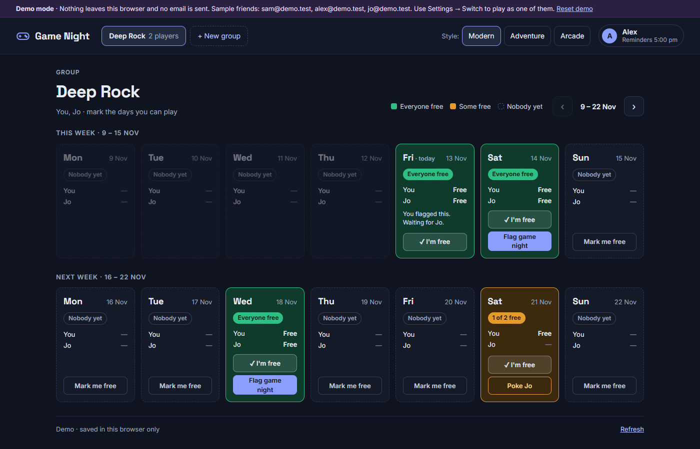

# Game Night

**Find the days everyone in your group is free, without the group chat back-and-forth.**

Everyone marks the days they're free over the next two weeks. Days go green when everyone is free. Someone flags a green day, the others confirm, and everyone gets a reminder email on the day.

It was built for a few friends who play games together, but nothing about it is really about games. Change one file of wording and it works for a book club, band practice, five-a-side, D&D, a team lunch, or a family dinner. See [Make it your own](#make-it-your-own).



**[Try the demo →](https://deanfourie1-ai.github.io/probable-happiness/?demo)** It runs entirely in your browser with made-up friends. Nothing is saved and no email is sent.

## What it does

- **Groups.** Make one group per activity and send friends an invite link. You can be in several groups.
- **Mark your free days.** Whole days only, no time slots. Each group has its own calendar.
- **See the overlap.** **Green** means everyone is free, **orange** means some people are, and blank means nobody yet.
- **Lock it in.** Flag a green day, and once everyone else has confirmed, it's on.
- **Poke.** Email someone who hasn't marked a day yet: "Sam wants to know if you can play Thursday".
- **Reminder.** On the day, each person gets an email at the time they chose, in their own time zone.
- **Three looks.** Each person picks Modern, Adventure (pixel-art sunset) or Arcade (16-bit). It only changes what they see.

There are no accounts or passwords. People type a name and email, and their browser remembers them.

## Is it right for you?

It's a good fit if:

- you're a small group of people who trust each other (friends, family, a club, a team);
- you plan in **whole days**, a week or two ahead;
- you want it free, with nothing to install and no app store.

It's not a good fit if:

- you need **time slots** ("Tuesday 2–4pm"). It only knows days;
- you need **privacy between members** or protection against strangers. Anyone with your site's link can join, and anyone who knows a member's email address can act as them. That's a deliberate trade-off for zero sign-up;
- you need it on **phones**. The layout is built for desktop;
- you need **instant updates**. People see changes when they open or refresh the page.

## How it works

```
Your website (GitHub Pages, free)
        │
        ▼
Google Apps Script (free) ──▶ sends emails from your Gmail
        │
        ▼
A Google Sheet in your Drive (this is the database)
```

- **Website:** plain HTML, CSS and JavaScript (`index.html`, `css/`, `js/`). No build step and no dependencies.
- **Backend:** a small Google Apps Script (`apps-script/`) attached to a Google Sheet that only you can open. It sends pokes and reminders from your Gmail, with no password or API key needed.
- **One set of rules:** `apps-script/Core.js` holds all the logic. It's used by the backend, by the demo mode and by the tests, so they can't drift apart.

Running your own copy costs nothing. Google lets a normal account send about 100 emails a day, which is far more than a group needs.

## Get your own copy

You'll need a Google account and a GitHub account. It takes about 15 minutes, with no coding.

1. **Fork this repo** (the **Fork** button at the top of the page), so you have your own copy.
2. *(Optional)* **Change the wording** in `apps-script/Words.js`. See below.
3. **Follow [docs/SETUP.md](docs/SETUP.md)**: create a Google Sheet, paste in the three script files, deploy it as a web app, put its URL in `js/config.js`, and turn on GitHub Pages.
4. **Open your site**, create a group and send the invite link to your friends.

> **Important:** `js/config.js` in this repo points at the original author's backend. Replace that URL with your own (step 3 covers it), or empty it to run in demo mode.

## Make it your own

All the words that make this "game night" are in one file, [`apps-script/Words.js`](apps-script/Words.js). The website, the emails and the tests all read from it.

```js
var GN_WORDS = {
  appName: 'Game Night',
  event: 'game night',
  eventShort: 'night',
  verb: 'play',
  when: 'tonight',
  reminderTitle: "You're playing tonight",
  member: 'player',
  members: 'players',
  groupLabel: 'Game tag',
  groupExample: 'Valheim',
  groupHint: 'Create a group for a game you play',
  pokeExample: "Keen for a few rounds? I'm free from 7."
};
```

Some examples:

| | Book club | Five-a-side | Team lunch |
|---|---|---|---|
| `appName` | `Book Club` | `Kickabout` | `Lunch Club` |
| `event` | `book club` | `match day` | `team lunch` |
| `eventShort` | `meet` | `match` | `lunch` |
| `verb` | `meet` | `play` | `come` |
| `when` | `tonight` | `today` | `today` |
| `reminderTitle` | `Book club is tonight` | `You're playing today` | `Lunch is on today` |
| `member` / `members` | `reader` / `readers` | `player` / `players` | `person` / `people` |
| `groupLabel` | `Club name` | `Team name` | `Team` |
| `groupExample` | `Sci-fi club` | `Tuesday regulars` | `Design team` |
| `groupHint` | `Create a group for your club` | `Create a group for your team` | `Create a group for your team` |
| `pokeExample` | `Finished the book yet?` | `We need one more for 5v5` | `Thinking tacos?` |

How the words are used:

- Write `event`, `verb` and the other lower-case words as they'd read in the middle of a sentence. The app capitalises them where needed.
- `event` appears in buttons and messages ("Flag book club", "Book club on Thu 19 Nov!") and in the reminder subject, together with `when` ("Book club tonight: Sci-fi club").
- `verb` finishes "Mark the days you can …" and "Sam wants to … Thu 19 Nov".
- `eventShort` is one word, used on the retro styles' small buttons ("Flag meet").

A few things the wording file doesn't change:

- **The browser tab icon** is a game controller. It's the `icon` link in `index.html`, and the same drawing (`ICON_PAD`) appears in the header in `js/app.js`.
- **The page description** for search engines and link previews is the `description` meta tag in `index.html`.
- **The Adventure and Arcade styles** are game-themed on purpose ("CREW", "PLAYERS", "PRESS START"). Their words are in the `STYLES` block at the top of `js/app.js`.
- **The demo's sample groups** are named after games (`seedDemo` in `js/api.js`).

If you change `Words.js` after setting up, paste the new version into the Apps Script editor and deploy a new version (see "Updating the script later" in [docs/SETUP.md](docs/SETUP.md)). Otherwise the emails keep the old words.

## Run it locally

```
npx serve .
```

Then open the address it prints. If `js/config.js` has no URL, or you add `?demo` to the address, the app runs in **demo mode**: sample friends, everything kept in your browser, and emails shown on screen instead of sent.

## Tests

```
npm test
```

You need [Node.js](https://nodejs.org/). This runs the rules tests and the backend tests (against in-memory fakes of Google's services). Neither needs a Google account. There are no packages to install.

## Project layout

| Path | What it is |
|---|---|
| `index.html`, `css/`, `js/` | The website |
| `js/config.js` | Your backend URL (empty = demo mode) |
| `apps-script/Words.js` | **The wording.** Change this to reuse the app |
| `apps-script/Core.js` | All the rules: groups, free days, flagging, confirming, emails |
| `apps-script/Code.js` | Connects the rules to Google Sheets, Gmail and the timers |
| `docs/SETUP.md` | Step-by-step setup |
| `docs/PLAN.md` | Design decisions and the reasons behind them |
| `tests/` | Tests, run with `npm test` |

## Licence

[MIT](LICENSE). Use it, change it and share it, including commercially. Just keep the copyright notice.
